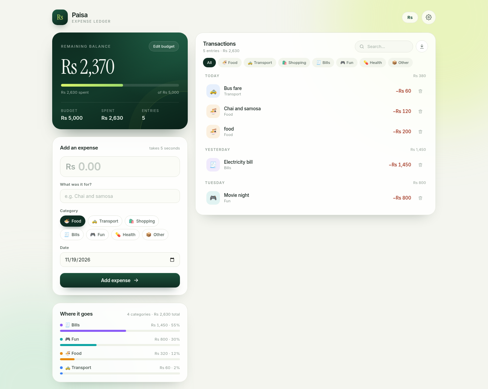

# Paisa — Full-Stack Expense Ledger

[](https://paisa-expense-ledger.onrender.com)
[](https://react.dev)
[](https://expressjs.com)
[](https://www.postgresql.org)

A calm, **Rs-first** expense tracker: log what you spend, watch your budget
balance update, and download a polished PDF report. React frontend, Express API,
and a real SQL database you can open in DBeaver.

**Live demo → <https://paisa-expense-ledger.onrender.com>**
*(free Render tier — the first visit may take ~30–60 s to wake up)*



## About

Paisa is a small, complete full-stack project built around one everyday job:
keeping track of personal spending without a spreadsheet. You enter an amount,
what it was for, a category and a date — the app keeps a running budget with a
remaining balance, a category breakdown, and a searchable, day-grouped ledger.

It is deliberately readable end to end: a React 19 frontend with no UI
framework, an Express 5 REST API with server-side validation, and a thin data
layer with interchangeable PostgreSQL, MySQL and SQLite adapters. That makes it
a good reference for how the pieces fit together — or a base to extend.

**Highlights**

- **Budget that means something** — live remaining balance, progress bar, and an
  over-budget warning instead of a silent negative number.
- **One currency, done properly** — everything is in Pakistani rupees and
  formatted as `Rs 1,250.00`; there is no misleading currency switcher.
- **PDF report in one click** — bordered tables, dark-green headers, and every
  expense amount highlighted in red, generated server-side with PDFKit.
- **A database you can actually inspect** — PostgreSQL on Render, MySQL 8
  locally, or SQLite with zero setup; all the same schema, all DBeaver-friendly.
- **Sensible API hygiene** — validation on every write, parameter-binding
  queries, a health endpoint, and graceful shutdown.
- **Small details** — animated totals, toast feedback, keyboard search
  (`Ctrl/Cmd + K`), responsive layout, and an empty state that explains itself.

> Paisa is a **single-user** app: there is no login or per-user data separation
> yet, so treat the public demo as a demo. Adding auth is the natural next step.

```
React (Vite)  ──HTTP──▶  Express API  ──▶  PostgreSQL (Render)
  :5173                     :4000      ├─▶  MySQL 8 (when configured)
                                        └─▶  SQLite file (local fallback)
```

The backend picks its database in this order: **PostgreSQL** when
`DATABASE_URL` is set (Render), then **MySQL**, then a local **SQLite** file.
That means the app runs immediately with zero database setup — and switches to
a hosted database in production.

## Stack

| Layer     | Technology                                      |
| --------- | ----------------------------------------------- |
| Frontend  | React 19, Vite 8, plain CSS                     |
| Backend   | Node.js, Express 5, pg, mysql2, node:sqlite     |
| Database  | PostgreSQL (Render), MySQL 8, or SQLite         |
| Dev tools | nodemon, concurrently, Vite proxy               |

## Quick start

```bash
npm run install:all   # already done if node_modules exist
npm run dev
```

Then open:

- **Frontend: <http://localhost:5173>**
- API health: <http://localhost:4000/api/health>

On first boot the backend logs which database it picked, e.g.:

```
[db] Using SQLite (MySQL not available)
[db] File: …/backend/data/paisa.db
```

## Using MySQL (optional)

To use MySQL instead of the SQLite fallback, create the database and app user
with the included script:

```bash
cd paisa-expense-ledger
sudo mysql < backend/setup.sql
```

Or open a SQL editor in DBeaver as an admin user and run `backend/setup.sql`.

Then restart `npm run dev`. With `DB_CLIENT=auto` in `backend/.env`, MySQL is
detected and used instead of SQLite (the server logs `[db] MySQL connected`).
To force a mode, set `DB_CLIENT=mysql` or `DB_CLIENT=sqlite`.

Credentials live in `backend/.env` (user `paisa`, password `paisa_dev_2026`).

## Connect with DBeaver

**SQLite (works right now, no setup):**

1. **Database → New Database Connection → SQLite**
2. Database file: `<project>/backend/data/paisa.db`
3. Open `Tables → expenses` and **View Data**.

**MySQL (after running `backend/setup.sql`):**

1. **Database → New Database Connection → MySQL**
2. Host `localhost` · Port `3306` · Database `paisa_ledger`
3. Username `paisa` · Password `paisa_dev_2026`
4. Test Connection → Finish → open `paisa_ledger → Tables`.

## Production build

```bash
npm run build   # React → frontend/dist
npm start       # Express serves the build + API on :4000
```

Open <http://localhost:4000>.

## Deploy on Render

The repo ships a `render.yaml` blueprint that creates **one free web service**
and **one free PostgreSQL database**, wires the connection string in, and
builds the React app at deploy time.

**This deployment:** <https://paisa-expense-ledger.onrender.com> — Node web
service + Render PostgreSQL 17, both on the free plan in the `oregon` region.

To recreate it from scratch:

1. Push the repo to GitHub.
2. In Render: **New → Blueprint**.
3. Pick the `expense-tracker` repo and click **Apply**.
4. Wait for the build, then open the service URL.

What the blueprint does:

| Setting | Value |
| --- | --- |
| Build | `npm ci --omit=dev && npm --prefix backend ci --omit=dev && npm --prefix frontend ci --include=dev && npm --prefix frontend run build` |
| Start | `npm --prefix backend start` |
| Health check | `/api/health` |
| Database | Render PostgreSQL, linked via `DATABASE_URL` |
| Static app | Express serves `frontend/dist` on the same origin |

Notes:

- **Free tier sleeps** after ~15 minutes of inactivity; the first visit takes
  ~30–60 seconds to wake it up.
- Render's **free PostgreSQL expires after 30 days** — upgrade the database or
  point `DATABASE_URL` at another Postgres (Neon, Supabase, …) to keep data. If
  you use an external URL, also set `DATABASE_SSL=true`.
- Prefer MySQL instead? Set `DB_CLIENT=mysql` plus the `DB_*` variables in the
  Render dashboard (Render does not host MySQL itself).
- Without any database env vars the app still runs on SQLite, but Render's
  filesystem is ephemeral, so data resets on restart/redeploy.

## Project structure

```
paisa-expense-ledger/
├── frontend/                 React app (Vite)
│   ├── src/
│   │   ├── components/       TopBar, BalanceCard, ExpenseForm, Ledger, …
│   │   ├── lib/              API client, money/date helpers
│   │   ├── App.jsx           state, data loading, actions
│   │   └── styles.css        the Paisa design
│   └── vite.config.js        proxies /api → localhost:4000
├── backend/                  Express API
│   ├── src/
│   │   ├── app.js            routes, validation, static hosting
│   │   ├── server.js         startup/shutdown
│   │   ├── validate.js       request validation
│   │   └── store/
│   │       ├── index.js      picks PostgreSQL, MySQL or SQLite
│   │       ├── postgres.js   PostgreSQL adapter (Render)
│   │       ├── mysql.js      MySQL adapter
│   │       └── sqlite.js     SQLite adapter
│   ├── setup.sql             optional MySQL database + user
│   ├── .env                  DB mode and credentials
│   └── data/paisa.db         SQLite database (created on first run)
├── legacy/                   previous vanilla-JS version (reference only)
├── docs/preview.png          screenshot used in this README
├── render.yaml               Render blueprint (web service + Postgres)
└── package.json              root scripts
```

## Database schema

All adapters expose the same shape and API.

**expenses**

| Column         | Type / values                                  |
| -------------- | ---------------------------------------------- |
| `id`           | integer, auto increment (primary key)          |
| `title`        | text, max 60 characters                        |
| `amount`       | decimal, always positive                       |
| `category`     | food, transport, shopping, bills, fun, health, other |
| `expense_date` | date (`YYYY-MM-DD`)                            |
| `created_at`   | creation timestamp                             |

**settings** — a single row (`id = 1`) with `budget`; the app uses a fixed
currency of **PKR**, displayed as **Rs** (the `currency` column is kept for
compatibility and always defaults to `PKR`).

## API

| Method   | Route               | Body / params                       | Returns                |
| -------- | ------------------- | ----------------------------------- | ---------------------- |
| `GET`    | `/api/health`       | —                                   | `{ ok, database }`     |
| `GET`    | `/api/expenses`     | —                                   | `{ expenses[] }`       |
| `POST`   | `/api/expenses`     | `{ title, amount, category, date }` | `201 { expense }`      |
| `DELETE` | `/api/expenses/:id` | —                                   | `204`                  |
| `DELETE` | `/api/expenses`     | —                                   | `204` (clear all)      |
| `GET`    | `/api/settings`     | —                                   | `{ budget, currency }` |
| `PUT`    | `/api/settings`     | `{ budget?, currency? }`            | `{ budget, currency }` |
| `GET`    | `/api/export.pdf`   | —                                   | `.pdf` report          |
| `GET`    | `/api/export.xlsx`  | —                                   | `.xlsx` report (opt.)  |
| `DELETE` | `/api/data`         | —                                   | `{ ok: true }`         |

Every request is validated on the server (amount > 0, title ≤ 60, valid date,
known category) and queries use parameter binding.

## Features

- Budget with live remaining balance and progress warnings
- Add/delete expenses stored in the database
- Category breakdown with percentages
- Day-grouped ledger with search and category filters
- Fixed currency: Pakistani Rupees (**Rs**) — no currency switcher
- **Download PDF report** (`.pdf`, drawn server-side with PDFKit, A4):
  - Green title banner and a “All amounts in Pakistani rupees (Rs)” subtitle
  - Summary boxes: budget / spent / remaining / entries
  - Boxed, bordered expense table with dark-green headers and zebra rows
  - Every expense amount in **red**, formatted as `Rs 1,250.00`
  - `TOTAL SPENT` row (red when over budget)
  - **Spending by category** table with counts, red totals, and % share
  - Repeating table header + “continued” marker across pages, page numbers in
    the footer, and cell text truncated with an ellipsis
  - Also available as a styled Excel workbook at `GET /api/export.xlsx`
- Loading, error/retry, and toast feedback
- Responsive layout, `Ctrl/Cmd + K` to search

## Notes

- `legacy/` is the earlier browser-only version; it is not used and can be
  deleted safely.
- For production, use a private `.env`, a strong database password, HTTPS, and
  rate limiting.
